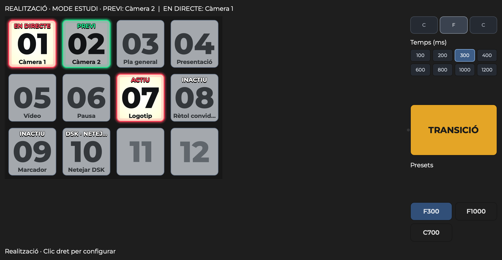

# OBS Control Deck · Botonera

Plugin natiu per a OBS amb una graella de botons quadrats, escenes seleccionades,
Downstream Keyer i controls de transició. Interfície inicial en català.
Utilitza Montserrat si està instal·lada; altrament conserva la tipografia d’OBS.



## Instal·ladors

**[Versió de proves 0.2.6 · GitHub Releases](https://github.com/lughdailh/obs-control-deck/releases/tag/v0.2.6)**

Descarrega el fitxer per al teu sistema:

- **[Windows x64 · Instal·lador EXE](https://github.com/lughdailh/obs-control-deck/releases/download/v0.2.6/Botonera-0.2.6-Windows-x64-Setup.exe)**
- **[Mac Intel i Apple Silicon · Instal·lador PKG](https://github.com/lughdailh/obs-control-deck/releases/download/v0.2.6/Botonera-0.2.6-macOS-universal.pkg)**
- [Guia de la primera instal·lació i prova](https://github.com/lughdailh/obs-control-deck/releases/download/v0.2.6/Botonera-LLEGEIX-ME.txt)

Tanca OBS abans d’instal·lar. Després obre **Acobladors → Botonera**.

Aquests són els paquets generats (també disponibles a `dist/` després d’empaquetar):

- **Windows x64:** `Botonera-0.2.6-Windows-x64-Setup.exe`. Per a OBS Studio 33,
  Windows 10/11 Intel/AMD, amb OBS tancat. Instal·la a ProgramData i afegeix un
  desinstal·lador a Aplicacions instal·lades. No és per a OBS portable ni ARM64.
- **macOS universal:** `Botonera-0.2.6-macOS-universal.pkg`. Assistent per a
  l’usuari actual, a `~/Library/Application Support/obs-studio/plugins`.
- `Botonera-LLEGEIX-ME.txt`: passos d’instal·lació i primera prova.

No inclouen OBS, Downstream Keyer ni la font Montserrat. Són paquets de prova
sense signatura comercial d’editor ni notarització. Windows està compilat i el
contingut de l’instal·lador verificat, però encara no s’ha executat en un PC.

La destinació Windows segueix el [format nou d’OBS 33](https://obsproject.com/kb/legacy-plugin-developer-info):
`C:\ProgramData\obs-studio\plugins\obs-control-deck\obs-control-deck.dll`, amb `data` al costat.
Els ZIP antics amb `obs-plugins/64bit` són el format legacy; per a un PC nou, utilitza l’instal·lador.
Per generar-los de nou i verificar-los, consulta [packaging/README.md](packaging/README.md).

## Ús

1. Mostra **Acobladors → Botonera**. Es pot acoblar sota els monitors o deixar flotant.
2. Amb **clic dret → Graella i mida**, tria **columnes × files** (màxim 200 caselles)
   i després la mida en píxels. Activa **Adaptar la mida** al costat dels píxels
   perquè la graella càpiga automàticament per amplada o alçada, mantenint els botons quadrats.
   La mida manual es conserva en desactivar-ho. Els canvis es previsualitzen al moment
   sobre la botonera; **Cancel·lar** recupera la configuració anterior.
3. Arrossega una escena des d'**Escenes** o un element de **Downstream Keyer** sobre una casella.
   El clic dret també permet **Afegir botó**.
4. Arrossega una imatge des del Finder o de l'Explorador sobre un botó. Queda integrada,
   sense preparar-ne les dimensions. Sobre una casella buida s'obre l'editor de l'acció.
5. En **configuració**, les accions queden aturades. Arrossega un botó a una altra posició per reordenar. Amb **clic dret** pots editar-lo
   o buidar-ne la casella. **Configurar la botonera** suspèn les accions mentre edites.
6. **Clic dret → Entrar en realització** bloqueja canvis i amaga
   les eines d'edició. Els presets es mantenen visibles i operatius per seleccionar ràpidament
   una transició i la seva durada. Per tornar a configurar: **clic dret → Configurar la botonera**.
   La capçalera indica sempre **CONFIGURACIÓ** o **REALITZACIÓ**. En realització les
   caselles buides són discretes i el clic dret ofereix tornar a configurar.
   El mode es conserva amb la col·lecció. La graella no canvia de forma en redimensionar el dock.

Quan comences una **transmissió o un enregistrament**, la botonera passa automàticament
a **realització**. El canvi s'aplica una vegada a l'inici: pots tornar a configuració
manualment durant l'emissió o la gravació. Un nou inici torna a activar realització.
Si hi ha un editor obert quan arriba l'inici, es tanca i descarta els canvis pendents.

En mode estudi, els botons d’escena seleccionen **previ**. El botó groc **TRANSICIÓ**
executa la transició automàtica cap a programa. CUT es conserva com a ordre de teclat, sense botó visible.
Fora del mode estudi, els botons d'escena actuen sobre programa; AUTO/CUT queden desactivats.

Sota TRANSICIÓ hi ha selectors discrets de 36 × 36 px per a cada transició disponible a OBS.
Mostren una abreviatura i el nom complet a l’ajuda del ratolí; un clic prepara la transició.
Arrossegar AUTO o un d'aquests botons amunt o avall ajusta la durada en passos de 10 ms
per píxel, sense executar la transició en deixar anar. També es poden escriure els ms.
Els presets guarden nom, tipus i durada; seleccionar un preset no executa AUTO.

Les cantonades tenen un radi de 8 px. El cos per defecte és gris neutre amb número
Montserrat ExtraBold fosc, visible també sobre les imatges i a les caselles buides.
La mida del número s’ajusta a l’espai: no es retalla quan la casella és petita.
Programa i DSK actiu tenen llum càlida contínua sobre tot el cos; previ té una
pulsació suau de 1,2 s. Els marcs vermell i verd es mantenen fixos.
A **Graella i mida…** pots amagar les etiquetes i, separadament, els textos d’estat.
El número sempre es mostra; si la casella és molt petita té prioritat sobre els textos.

## Distribució de les transicions (0.2.6)

A la dreta de la graella d’escenes hi ha una única columna: selectors de tipus
amb una inicial a dalt, una quadrícula de temps en mil·lisegons a sota,
TRANSICIÓ centrat verticalment, i presets en
una quadrícula de dues columnes a baix. Cut sempre és C, Fade és F i Move és M;
els altres tipus mostren la seva inicial. L’ordre és C, F, M i la resta.
Els selectors ocupen tota l’amplada del panell. Els temps ràpids són 100, 200,
400, 600, 800, 1000 i 1200 ms; si el temps actual és diferent, també apareix.
Tipus i temps queden marcats; el tall desactiva la tria de temps.
La selecció prepara la transició; només TRANSICIÓ l’executa. Els presets afegeixen els mil·lisegons
(F100, M300…), excepte el tall, que mostra C. Els noms complets continuen als
tooltips i a l’editor. Les alçades es calculen després d’aplicar el tema d’OBS.

Els números de les caselles es mostren com 01, 02… 09, 10… amb pes Black;
el contorn dels glifs queda centrat al botó sencer, independentment de textos
i etiquetes.

En mode configuració, els botons amb dreceres assignades mostren una etiqueta
amb la tecla o combinació; en realització s’amaga.

En mode configuració, arrossega el separador per ajustar l’amplada de la graella
i del panell dret. L’amplada es desa amb la col·lecció i s’inclou a l’exportació.
En realització, el separador queda bloquejat. El PREVI conserva la cadència de
1,2 segons, amb passos entre llum alta i baixa més ràpids.

## Personalitzar els controls de transició

En **configuració**, fes **clic dret sobre TRANSICIÓ, un selector de transició o un preset**.
L'editor permet triar o treure una imatge i assignar una drecera desbloquejant el candau.
També pots arrossegar una imatge directament sobre aquests controls; queda integrada.

Per exemple, pots assignar **Enter a TRANSICIÓ**. Les dreceres CUT que ja hi havia es conserven; també es poden editar a les dreceres natives d’OBS. No es defineixen
combinacions per defecte per evitar col·lisions amb les teves dreceres d'OBS.
Les dreceres són natives d'OBS i es desen amb la col·lecció i l'exportació. S'avisa de
coincidències dins la botonera i de possibles assignacions a OBS o al sistema.

AUTO executa la transició i CUT fa el tall, en mode estudi. Els botons dels tipus i
els presets seleccionen la transició; després AUTO l'executa. En configuració els
controls admeten clic dret i imatges, però no executen accions sobre la sortida.

## Dreceres

Amb **clic dret → Editar botó**, tens un camp **Drecera de teclat**. Desbloqueja
el candau de la dreta, prem la combinació i desa. El camp torna a estar bloquejat
quan obres l'editor. S'avisa si coincideix amb un altre botó; OBS o el sistema també
poden tenir aquesta combinació assignada. La drecera s'integra al sistema natiu d'OBS.
Si OBS té diverses dreceres per al botó, aquí s'edita la principal i es conserven les altres.
Les tecles especials no representables es conserven mentre no les canviïs.

A **OBS → Configuració → Dreceres**, cerca **Botonera**:

- **Mostrar/amagar la botonera**, que és una preferència global.
- Una acció per a cada botó configurat, guardada amb la seva col·lecció.

No s'assigna cap combinació per defecte. El comportament global depèn de la política
que tingui configurada OBS per a les dreceres i dels permisos del sistema.

## DSK

Cal tenir [Downstream Keyer](https://obsproject.com/forum/resources/downstream-keyer.1254/)
i obs-websocket carregats. S'utilitza l'API **local** d'obs-websocket per a
`CallVendorRequest`: no cal activar el servidor de xarxa ni configurar una contrasenya.

Es llegeixen els canals i elements de la sortida principal. Un botó DSK alterna el seu
element amb el canal buit: un clic el mostra i el següent l’amaga. S’utilitza la
transició d’entrada/sortida configurada al Downstream Keyer, incloses les
sobreescriptures de l’escena que apliqui el complement; AUTO, CUT i els presets
de la botonera no canvien aquest efecte. També hi ha l’acció **Netejar canal DSK**.
Només pot estar seleccionada una composició per canal: triar-ne una altra la substitueix.
Amb **TIE** activat, l'acció es bloqueja i s'explica al peu del panell.

DSK actua sobre la sortida en directe. Seleccionar un element al panell DSK original
pot activar-lo abans de començar a arrossegar-lo: aquest és el comportament del complement.
La botonera no afegeix una activació en rebre l'arrossegament.

## Guardat i portabilitat

La configuració es guarda a la col·lecció d'escenes, sota `modules.obs-control-deck`.
Les imatges es normalitzen internament a PNG de fins a 512 px i es guarden dins del JSON;
no depenen d'una ruta de disc. Admet imatges locals compatibles amb Qt de fins a 32 MB.

**Opcions → Exportar amb imatges** inclou botons, posicions, imatges, presets,
bloqueig i dreceres dels botons. Importar demana confirmar la substitució.
Per canviar d'ordinador també cal traslladar la col·lecció d'OBS: l'exportació de la
botonera no crea fonts, escenes, dispositius ni canals DSK. Les escenes es referencien
per UUID; els elements DSK, pel nom de canal i escena. Els elements absents s'indiquen.

Una configuració guardada amb format desconegut es conserva sense sobreescriure-la.
Es pot substituir explícitament amb una importació vàlida.

## Compilació

Basat en la [plantilla oficial de plugins d'OBS](https://github.com/obsproject/obs-plugintemplate).
C++17, Qt 6 i OBS Frontend API. L'SDK de referència és OBS 31.1.1 / Qt 6.8.3.

Mac (Xcode, universal Intel + Apple Silicon):

```sh
cmake --preset macos -DBUILD_TESTING=ON
cmake --build --preset macos
ctest --test-dir build_macos -C RelWithDebInfo --output-on-failure
```

Windows (Visual Studio 2022, x64):

```powershell
cmake --preset windows-x64 -DBUILD_TESTING=ON
cmake --build --preset windows-x64
ctest --test-dir build_x64 -C RelWithDebInfo --output-on-failure
```

La plantilla descarrega l'SDK i les dependències. Les proves Qt necessiten que els
plugins de plataforma de la mateixa versió de Qt estiguin disponibles.
`CONTROL_DECK_LOCAL_SDK` permet reutilitzar un SDK macOS existent.
`tools/windows-cross` permet una compilació x64 amb clang-cl/lld i un SDK Windows
existent; és una comprovació de compilació, no una prova d'execució en Windows.

## Abast i límits

Aquesta versió cobreix escenes, DSK, transicions, presets, imatges, dreceres,
caselles i bloqueig. Altres tipus d'accions —àudio, filtres, multimèdia i macros—
queden per a una ampliació.

S'utilitza el comportament estàndard de transicions d'OBS: les sobreescriptures de
transició que tingui una escena continuen aplicant-se. DSK secundaris associats a
altres canvases no estan exposats en aquesta versió. Encara cal provar l'execució
en un PC Windows i en un Mac Intel; compilar per a aquestes arquitectures no ho acredita.

Llicència GPL-2.0-or-later. `src/obs-websocket-api.h` prové del projecte
[obs-downstream-keyer](https://github.com/exeldro/obs-downstream-keyer).

## Automatismes de compilació

Les definicions de GitHub Actions es conserven a `.github/workflow-templates`
com a plantilles inactives. La publicació inicial inclou binaris generats i
verificats localment; no es presenta cap execució de CI com a validació del PC.
La primera versió pública és una instantània completa de la 0.2.6; es conserva
la llicència i l’atribució a la plantilla oficial d’OBS.
